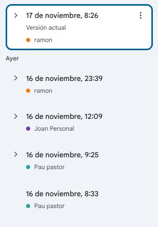

# UD4.1b · Comparativa de suites ofimáticas — Grupo 3

**IAW · 2º ASIR**

- **Integrantes:** Pablo, Ramon, Joan
- **Suites:** Zoho Workplace vs Collabora Online
- **Cliente:** C - Ayuntamiento, 40 empleados, un informático, debe cumplir el ENS

## Tabla comparativa

| Criterio | Zoho Workplace | Collabora Online |
|---|---|---|
| **Herramientas que incluye** | Correo (Zoho Mail), Writer (textos), Sheet (hojas), Show (presentaciones), WorkDrive (archivos), Cliq (chat), Meeting (videollamadas), Calendar. | Solo editores web basados en LibreOffice: Writer (textos), Calc (hojas), Impress (presentaciones) y Draw. No trae correo, chat ni almacenamiento: se integra en Nextcloud, ownCloud… |
| **SaaS, autoalojado o ambos** | SaaS: solo en la nube de Zoho, se usa desde el navegador o la app. | Ambos, aunque sobre todo autoalojado (en un servidor propio). También hay proveedores que lo ofrecen alojado. |
| **Licencia** | Software propietario y de pago por suscripción (SaaS). Standard: 3 $/usuario/mes con pago anual (4 $ con pago mensual). Professional: 6 $/usuario/mes con pago anual (7 $ mensual). Hay un plan gratuito, pero solo incluye correo. | Software libre (licencia MPL 2.0, basado en LibreOffice). La versión CODE es gratis, pero solo para pruebas y sin soporte. Para empresas, Collabora Online for Business cuesta 3 €/usuario/mes, hasta 99 usuarios, y se instala en un servidor propio. |
| **¿Se edita a la vez?** | Sí, en tiempo real, en el navegador (Writer, Sheet y Show) y desde las apps móviles. Cada persona aparece con un color y los cambios se guardan solos. | Sí, en tiempo real, en el navegador, integrado en Nextcloud u ownCloud. Se ven los cursores de los demás y se pueden dejar comentarios. Los documentos se quedan en el servidor propio. |
| **Dónde se guardan los datos** | En la nube de Zoho (no se puede autoalojar). Para clientes europeos (zoho.eu), en sus centros de datos de la UE: Ámsterdam (Países Bajos) y Dublín (Irlanda). <https://www.zoho.com/blog/index.php/general/zoho-data-centers-in-europe.html> | Donde se instale: normalmente en un servidor propio del cliente (on-premise), junto a Nextcloud u ownCloud, o en un proveedor de hosting que elija. Los documentos no salen de esa infraestructura. <https://www.collaboraonline.com/security/> |
| **Punto fuerte / punto débil** | **Fuerte:** suite completa (correo, chat, videollamadas, almacenamiento) lista para usar y sin mantenimiento. **Débil:** los datos dependen de un proveedor externo y no se puede instalar en un servidor propio. | **Fuerte:** control total de los datos, software libre (sin licencia en la versión comunitaria) y formatos abiertos (ODF). **Débil:** hay que instalarlo y mantenerlo, y no incluye correo ni chat (necesita Nextcloud u otra plataforma). |

## Recomendación para el cliente

Recomendamos Collabora Online (con Nextcloud) instalado en un servidor del Ayuntamiento o de un proveedor nacional. Como administración pública debe cumplir el ENS y el RGPD, y así los datos de los ciudadanos quedan bajo su control y en España; además, su informático puede mantenerlo y se ahorran licencias. Descartamos Zoho Workplace porque es solo SaaS y no se puede autoalojar, lo que complica cumplir el ENS.

## Historial de versiones

Aquí podemos observar las diferentes versiones del mismo documento con las cuales hemos trabajado, pudiendo ver así que no hemos necesitado compartir varias veces el documento compartido si no que hemos trabajado con el mismo todos.
